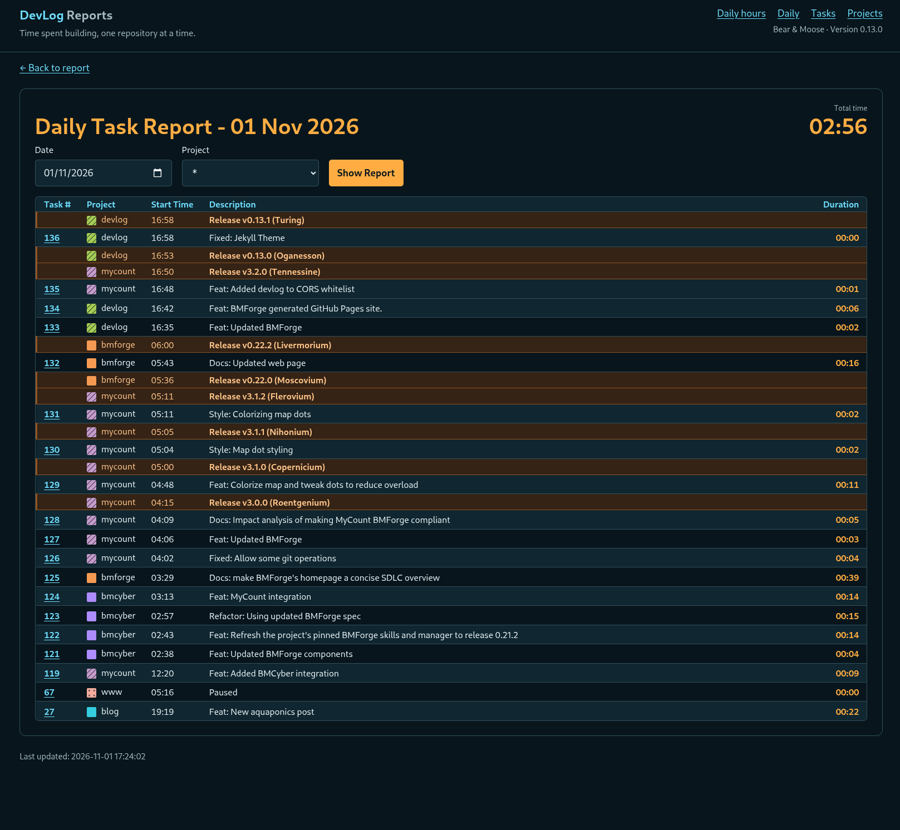

**DevLog** tracks time spent working in GitHub repositories. This is an application that
I developed for myself. I wanted to get a sense of how much time I was spending on my
Open Source projects.

The app supports viewing the tasks for a day or for a project.

Task times can be edited.

---

## User Guides

- [Installation]({{ site.baseurl }}): install,
  configure, upgrade and remove the client or server.
- [Tracking work]({{ site.baseurl }}): start and
  pause tasks, complete work with a commit, and record releases.
- [Reports]({{ site.baseurl }}): review daily hours and
  project history, and correct completed work intervals.
- [Changelog]({{ site.baseurl }}): release history and
  recent changes.

[Source code on GitHub](https://github.com/NadimGhaznavi/devlog)

